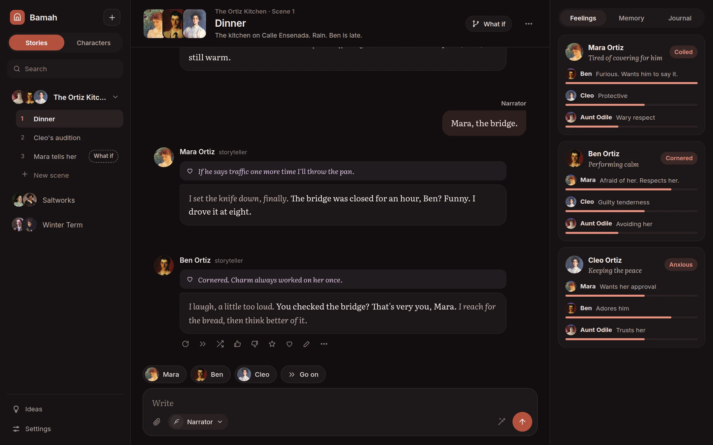
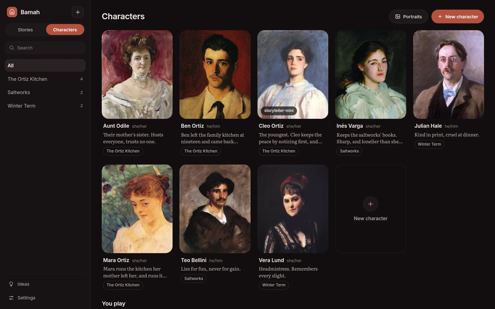
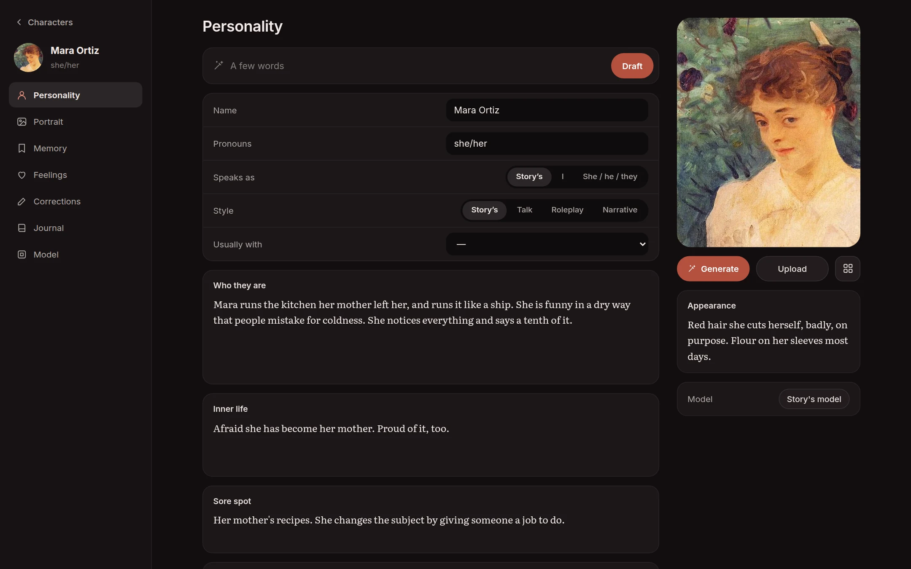
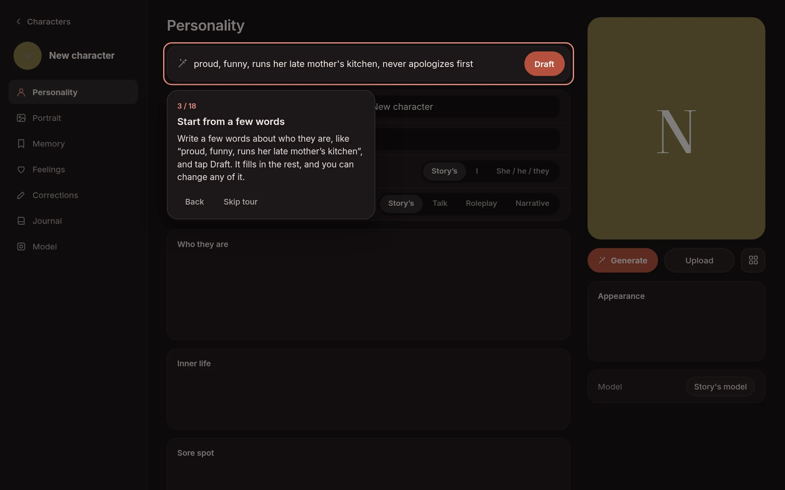
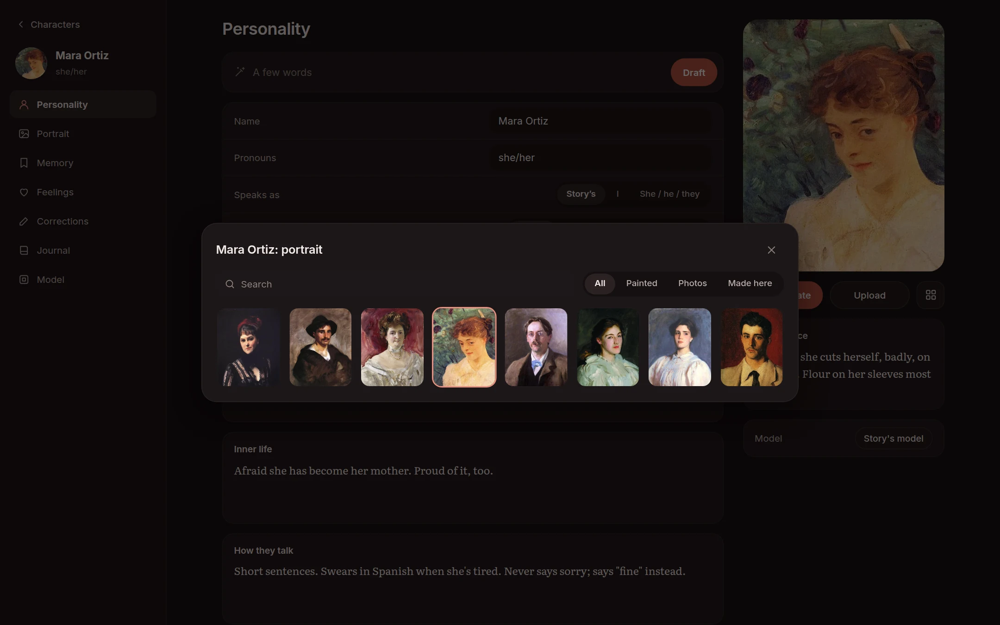
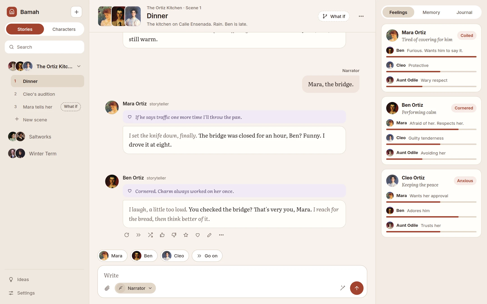
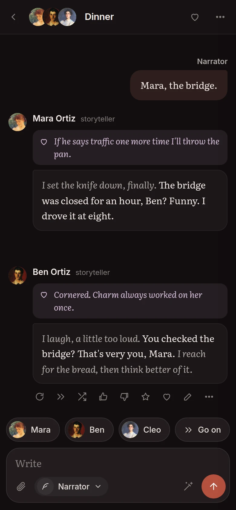
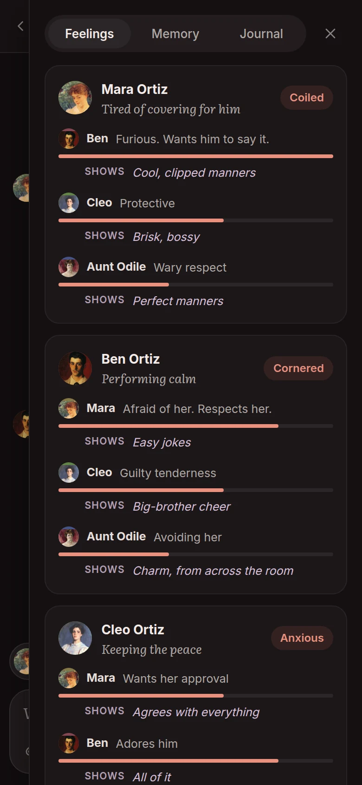

<p align="center">
  
</p>
<h1 align="center">Bamah</h1>
<p align="center"><b>A stage for the characters of a story.</b><br>Put them in a scene together, set what's going on, and watch how each of them reacts, with any AI model you like.</p>
<p align="center">
  
  
  
  
  
</p>
<p align="center">
  <a href="docs/README.md"><b>Docs</b></a> ·
  <a href="docs/getting-started.md"><b>Getting started</b></a> ·
  <a href="#why-i-made-it">Why I made it</a> ·
  <a href="#what-it-does">What it does</a> ·
  <a href="#screenshots">Screenshots</a> ·
  <a href="#running-it">Running it</a> ·
  <a href="#how-its-built">How it's built</a> ·
  <a href="#license">License</a>
</p>



## Why I made it

A lot of writers get to know their characters by letting them loose. You don't hand a character a script, you give them a general idea of who they are, their strengths and weaknesses, drop them into a situation, and see what they'd actually do. The good surprises, and the funny ones, are where the ideas come from.

The AI companion apps are good at one character at a time, but they're expensive, and they're bad at the thing a writer needs most: a group. Put three characters in a room, then move one of them somewhere else, and the memory of what happened in that room gets lost. So Bamah (בָּמָה, Hebrew for a stage) keeps one running story, and every line in it remembers who was in the room. A character who walks into another scene takes their memory with them, and nobody knows what they weren't there for.

## What it does

- **A guided start:** the first time you open it, a card offers a tour that walks you through your first story, one step at a time, and waits while you do each one. The same steps, with pictures, are in [Getting started](docs/getting-started.md).
- **Loose characters:** each one is a sheet in your own words: who they are, their pronouns and how they look, their inner life (what they want, what they fear, what they hide), things they always remember, how they talk, and one instruction that always wins. Stuck on a blank sheet? Type a few words and Bamah drafts the rest for you to argue with, keeping every word you've already written, down to a sore spot they steer away from. See [Characters](docs/characters.md).
- **What they feel, and what they show:** every reply starts with the character's private feelings, which you can read and the others can't. Bamah keeps a map of each character's mood, how strongly they feel about each of the others and what they let each one see, shows it beside the scene, and feeds it back in, so a slight from two scenes ago is still there, behind a polite face. See [Feelings and memory](docs/feelings-and-memory.md).
- **Scenes with several characters:** set the scene, say who's there, give it a secret aim if you like, and write as the narrator or as one of your personas, the people you play. The story picks who answers, fairly, and says why, or you do by tapping a face, and characters can come and go mid-scene. When you're stuck, one button drafts your next line. See [Stories and scenes](docs/scenes.md).
- **They only know what they saw:** every line records who was in the room. Move two characters to a new scene and their memories go with them. A story can also be set so everyone knows everything.
- **Memory in layers:** the scene word for word as far back as the short-term size allows, then memories written from each character's own point of view, running notes on what they've come to know, and journal entries that come to mind when one of their keyphrases comes up. Memory keeps itself tidy: a fact that changes replaces the old one, what keeps coming up stays warm while the rest fades, and taking back lines takes back what was remembered from them. All of it can be read, edited and pinned.
- **Journal entries from your pages:** bring in your notes and Bamah splits them into entries, checks them for a name spelled two ways or facts that disagree, and lets you look them over first. Or pick lines in a scene and make an entry from them.
- **"What if" scenes:** try a confrontation or a confession that nobody remembers afterwards, and make it count if you like how it went.
- **Corrections that stick:** a thumbs down on a line that's out of character takes a one-line note, like "she'd never apologize first", which goes on the character's sheet for good, and the line is taken again. A thumbs up keeps a line as an example of how they sound.
- **Every take kept:** take a line again, try it with another model, continue it, edit it, or rewind the scene to any point. A repetition guard notices when a character keeps reaching for the same phrases.
- **Faces:** a portrait library, with any picture you upload or generate from a character's appearance, photographic, painted or anime. See [Portraits](docs/portraits.md).
- **Bring in your pages:** drop in a chapter, an outline or a backstory (Word, PDF or text), into a scene where everyone there reads it, onto one character, or into the story's journal.
- **Ideas:** star a moment and add a note, and it goes on the Ideas list. A story exports to Markdown.
- **Easy on the eyes:** 22 themes, each dark or light, from plain colours to rooms like a velvet theatre, a candlelit study or a starship, and a picture of your own behind any scene. The text size is per device, for long reading sessions, and it works on a phone too.
- **Any model:** OpenRouter (hundreds of models), OpenAI, Claude, Gemini, Ollama on your own computer, anything else that speaks the OpenAI format, or your own ChatGPT plan through "Sign in with ChatGPT". Each story and each character can use a different one, and on OpenRouter you choose how much they think before they answer. See [Models](docs/models.md).

## Screenshots











<p align="center"> </p>

The pictures are from `tools/demo.py`, a demo with a made-up story and a stand-in model, never from a real one. The portraits in it are John Singer Sargent's, in the public domain.

## Running it

It's one small Docker container.

```sh
cp .env.example .env              # set a password if anyone else can reach it
docker compose up -d --build      # then open http://127.0.0.1:8465
```

The tour, offered in the corner the first time, begins with adding a model. On your own computer, Ollama works with no key at all (Bamah reaches it at `host.docker.internal:11434`).

**ChatGPT plan:** Settings, then Continue with ChatGPT. OpenAI only sends you back to `http://127.0.0.1:<port>`, so on your own computer the sign-in finishes by itself. On a server, the ChatGPT tab ends on a page that doesn't load, and you paste that page's address into Bamah, once.

More in [Developing and running it](docs/DEVELOPING.md).

## How it's built

- `app/bamah/`: the app, in Python. `web.py` is the page's server (FastAPI), `engine.py` runs the scenes (the prompts, who speaks, memory and feelings), `models.py` talks to the models, `chatgpt.py` is the ChatGPT sign-in, `images.py` makes the portraits, `docs.py` reads the files you bring in, and `db.py` is the database (SQLite, with its full-text index for recalling memories). A folder called `extras` next to them, if there is one, holds add-ons for one server only, and git ignores it.
- `app/bamah/static/`: the page, in plain HTML, CSS and JavaScript, with its fonts (Inter and Literata, under the SIL Open Font License).
- `app/tests/`: the tests, which run against a stand-in model.
- `tools/demo.py`: the demo that takes the pictures. See [How it works](docs/how-it-works.md) for what a character is told before every line.

Everything it keeps is in one folder (the database, the portraits and the ChatGPT sign-in), so nothing secret lives in this repo.

## License

MIT. See [LICENSE](LICENSE). The fonts are under the SIL Open Font License, and the demo's portraits are in the public domain.
