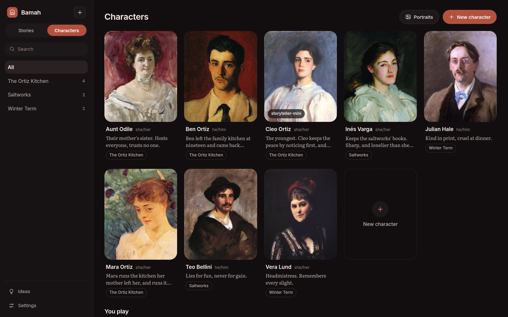
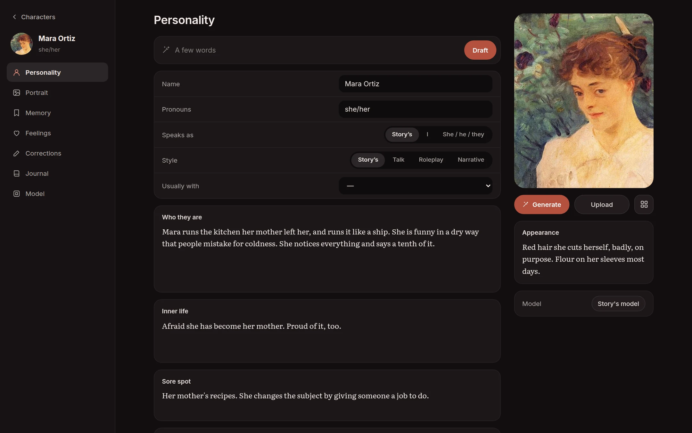

[Bamah docs](README.md) › Using it

# Characters

**Characters** shows everyone you've made, as portrait cards, with their pronouns, a line about them, the stories they're in and, if they have their own, their model. The list on the left narrows it to one story's cast, and the search box finds someone by name.

A character belongs to you, not to a story, so the same person can be in several stories. What they remember and feel is kept per story.

## Their page

Tap a character to open their page. The menu down the side has their **Personality**, **Portrait**, **Memory**, **Feelings**, **Corrections**, **Journal** and **Model**.

### Drafting from a few words

The box at the top takes a few words, like "sad, funny, works the morning shift, hates cinnamon", and **Draft** writes the sheet from them: pronouns, appearance, who they are, their inner life, their sore spot, how they talk and what they always remember.

Anything you've already written stays exactly as you wrote it. Draft only fills in the empty boxes, and makes them fit what's there, so you can write the one thing you know about someone and let it suggest the rest. When there's something on the sheet already, the few words can even be left out. Only when every box is full does it ask whether to replace it all.

It aims for a person rather than a type: every trait tied to something they do or carry, two wants that pull against each other, a sore spot, and a line where they dodge or refuse something. Not everyone comes out wounded, unless your words point that way.

### The sheet

- **Name** and **Pronouns.**
- **Speaks as:** "I", or "she", "he" or "they", or whatever the story uses. "I" means their actions come in asterisks, like `*I set the knife down.*`
- **Style:** **Talk** (just what they say), **Roleplay** (what they say and do), or **Narrative** (novel prose). **Story's** follows the story's setting.
- **Usually with:** one of your personas, if you usually play opposite this character. See [Stories and scenes](scenes.md#you-play).
- **Who they are:** their story, their traits, the way they come across.
- **Inner life:** what they want, what they fear, what they hide.
- **Sore spot:** a topic, a name or a thing they steer away from. When someone presses on it, they react, in their own way.
- **How they talk:** their voice, the words they use and don't.
- **Always remembers:** a few facts that are always in front of them.
- **Always:** one instruction that always wins, like "never says I love you first".
- **Appearance** sits beside the portrait. Everyone in a scene with them is told what they look like, and portraits are made from it.

Everything saves as you type.

## Corrections

When a character says something they never would, use the thumbs down on that line and write what they'd really do. **Save and redo** keeps that note on their **Corrections** page for good, and takes the line again. **Redo** only takes it again, this once.

A thumbs up keeps a line as an example of how they sound. Those are under **Sounded right** on the same page, and the character sees some of them before they speak.

## Their journal

The **Journal** is notes that come to mind when one of their keyphrases comes up in a scene: a person's name, a place, an object. Each entry has a title, keyphrases separated by commas, and the note itself. **File** brings in a Word document, PDF or text file, like a backstory you've already written, either **As one entry** or **Split into entries**. See [Feelings and memory](feelings-and-memory.md#journal-entries-from-your-pages).

A keyphrase counts as a whole word, or its plural, so "Ben" brings up Ben's entry when someone says "Ben's coat" but not "bench". An entry with no keyphrases is always in mind. At most eight entries come to mind at once. The pin puts an entry ahead of the others when more than eight come up, and the switch beside it takes an entry out of mind without deleting it. **Try a line**, above the entries, shows which ones a sentence would bring up, without asking a model anything. Entries it would leave out because there are more than eight show struck through.

A story has a journal of its own for things everyone in it would know, and **Settings** has a shared journal for every story.

## Their model

**Model** gives this character a model of their own. Otherwise they use the story's, and the story uses the default from Settings. To delete a character, use the **…** beside their name, or the one on their card under **Characters**. Their lines stay in the scenes they were in.

Next: [Stories and scenes](scenes.md)
