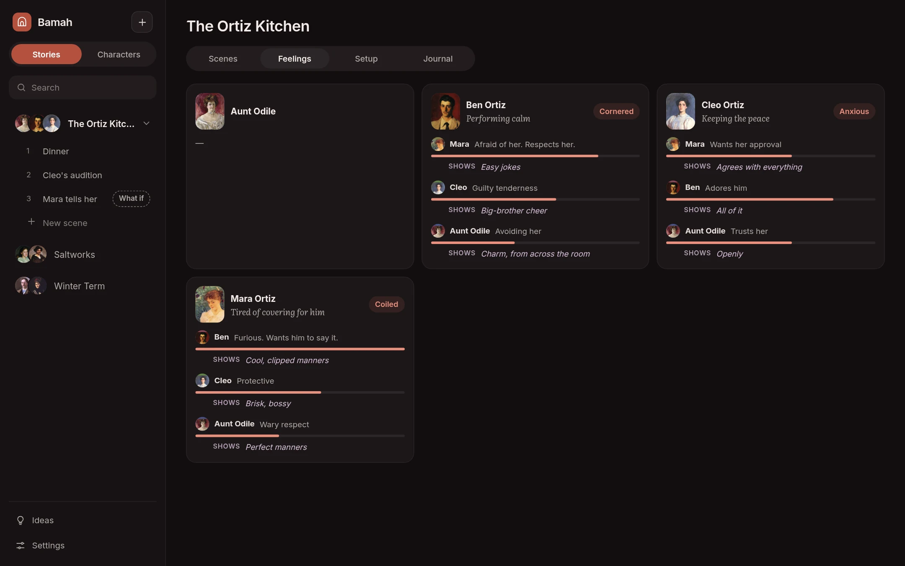

[Bamah docs](README.md) › Using it

# Feelings and memory

This is the part I care about most. A character in Bamah isn't just a voice for the next line. They feel something about the people around them, that feeling carries over from scene to scene, and they only remember what they were there for.

## What they don't say

Every reply starts with a private line: what the character feels, wants or is hiding right then. It's shown in lilac above what they actually say. It shapes their answer, only you can see it, and the other characters never do. The heart under a line shows or hides it, and **Hide what they feel** in the scene menu hides it for the whole scene.

## The Feelings panel

After every line, Bamah reads the moment and updates how that character feels: their mood in a word and a phrase, and how they feel about each of the others in the story, with how strongly, from 1 to 5. That's the **Feelings** panel beside a scene, and the story's **Feelings** tab for the whole cast.

It also keeps what they let each person see, under **Shows**, in lilac. Mara can be furious with Ben and show him nothing but polite cheer. The next time she speaks, she's told both, and to act on what she shows, letting what she feels leak out only in small ways: a pause, a word too many, a joke that lands wrong.

*How each of them feels right now, and about each other.*

The next time a character speaks, they're told how they feel now, so a slight from two scenes ago is still there. A character's **Feelings** page keeps every earlier state too, under **Earlier**, so you can follow how it changed.

The panel's **Memory** tab shows what each character in the room remembers of this story, and **Journal** has the story's journal.

Tracking feelings uses the model in **Settings › Default › Memory and turn order**, and can be turned off under **Settings › Memory › Feelings**.

## They only know what they saw

Every line in a scene records who was in the room when it was said. When Ben leaves the kitchen, nothing said after that reaches him, and when two characters move on to a new scene, they take what they saw with them. Before a character speaks, Bamah makes sure everything they witnessed elsewhere in the story is in their memory.

A story can instead be set so **Everyone knows everything**, under **Setup › Memory**.

## How memory is layered

1. **The scene itself, word for word,** as far back as the short-term size allows (**Settings › Memory › Short-term**).
2. **Memories:** when older lines fall out of short-term, and when a scene ends, each character writes down what they'll remember of it, in a few lines from their own point of view. Before every reply, the memories that match what's happening come back to them (**Memories recalled per reply**).
3. **Come to know:** running notes on what they've learned in this story, about the others and the situation, rewritten as they go.
4. **Always remembers** on their sheet, which is always there.
5. **Journal entries** that come to mind when one of their keyphrases comes up.

All of it is on the character's **Memory** page, per story: the notes under **Come to know**, and the memories, which you can edit, pin so they always come back, delete, or add to by hand.

## Memory that keeps itself tidy

- **Facts that change are replaced.** When new memories are written, the character's memory-keeper sees what they already remember. If Mara used to live in Lyon and now lives in Paris, the new memory replaces the old one, which stays on the **Memory** page, struck through and marked **Replaced**, but no longer comes back to her. Things that happened are never replaced, only facts that changed. And nothing gets written down twice.
- **What keeps coming up stays warm.** Every time a memory comes back to mind it grows warmer, and every time new memories are written, the others cool a little, more slowly for the ones that come back often. Warm memories come back more readily, and ones that have faded show dimmed and come back less. Pinned memories never fade.
- **Taking back lines takes back their memories.** Each memory knows which lines it was written from. When you rewind or delete those lines, the memories written from them go too, anything they replaced comes back, and the lines that are left get written down again.

## Journal entries from your pages

When you bring a file into a journal, a story's, a character's or the shared one, you can keep it **As one entry** or **Split into entries**. Splitting has the helper model read it, in pieces if it's long, and write one entry for each person, place, object or piece of history in it, each with its title, keyphrases and your own words wherever it can. Then it checks them: the same keyphrase on two different things, a name spelled two ways, or facts that contradict each other, also against what's already in the journal. Each of those comes up on top, with **Keep**, **Merge** or **Keep both**, and nothing is added until you tap **Add**.

In a scene, **Make a journal entry** in the menu lets you pick lines, and the helper writes one entry for the story's journal from them, for you to look over, or says there's nothing in them worth keeping.

## What-if scenes

A what-if scene leaves nothing behind: no memories, and no change to how anyone feels. **Make it count** in its menu turns it into a real scene, and then it's remembered like any other.

Next: [Portraits](portraits.md)
