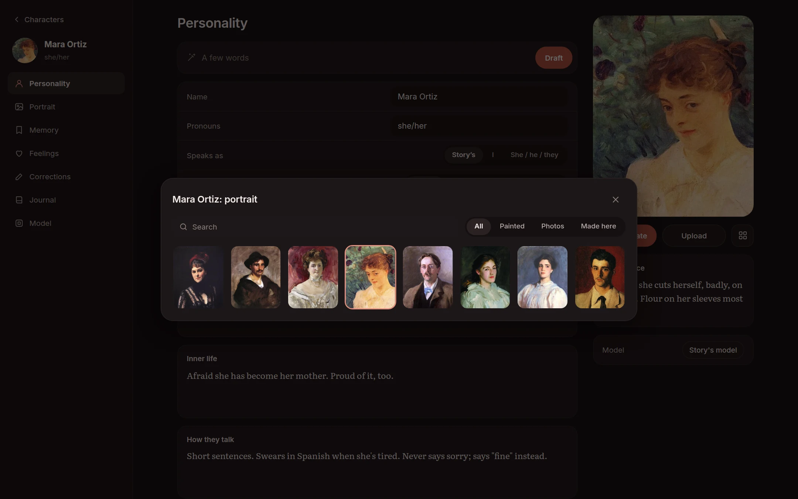

[Bamah docs](README.md) › Using it

# Portraits

A face makes a character easier to hold in your head. Every character can have one, shown on their card, beside their lines and in the Feelings panel.

## The library

Every portrait is kept in one library, so a face can go to anyone. It opens from the square button under a character's portrait, or **Portraits** on the Characters page.

**All**, **Painted**, **Photos** and **Made here** narrow it down, and the search box finds one by its title or the painter's name. Tap a portrait for **Use**, **Where it's from**, **Copy description** (for one that was generated) or **Delete**. Deleting one that a character is wearing takes it out of the library, but not off the character.

On my Bamah, the library also has several hundred portraits that are in the public domain: paintings by Sargent, Zorn, Boldini, Cassatt, Raja Ravi Varma and many others, and old studio photographs. Each one keeps its title, artist and date. They're not part of this repository, so a new Bamah starts with only the portraits you add.

## Making one

**Generate** paints a portrait from the character's **Appearance**, in the style you choose on their **Portrait** page: **Photoreal**, **Painted** or **Anime**. It needs an image model, chosen in **Settings › Default › Portraits** (an OpenAI or Gemini image model, or one on OpenRouter that makes pictures). Each portrait is kept with the description that made it, so you can make another in the same spirit.

## Uploading one

**Upload** takes any picture from your computer or phone. It goes into the library too.

Next: [Models](models.md)
