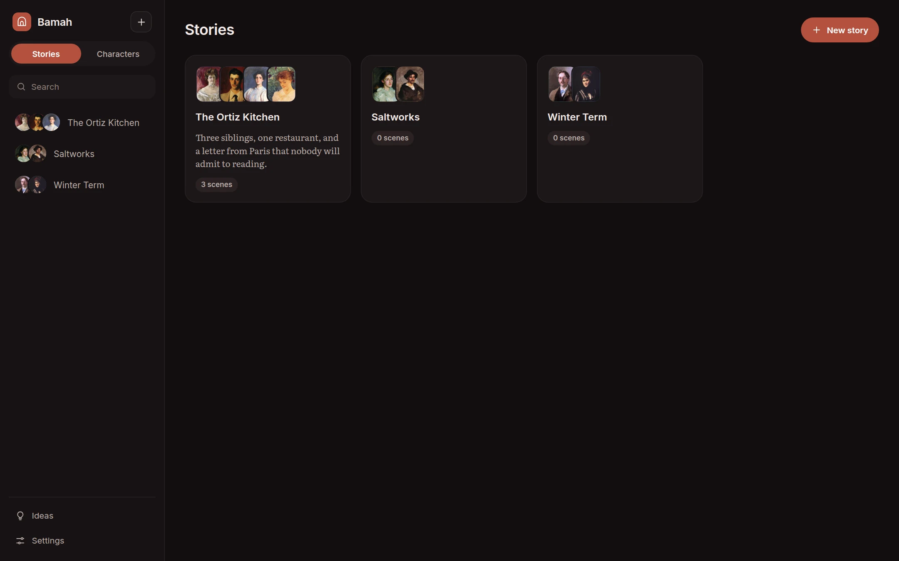
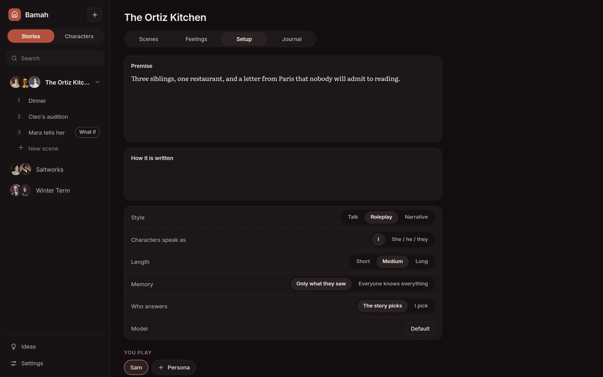
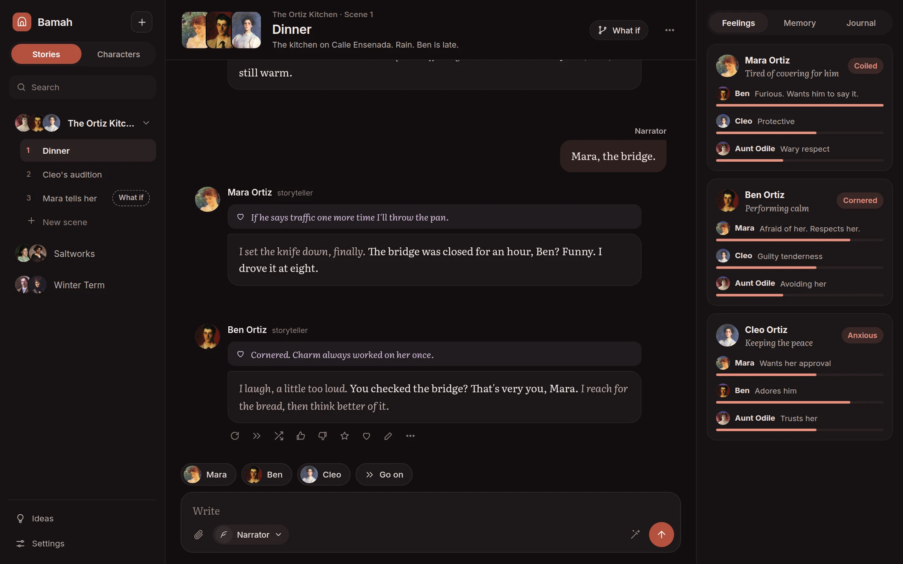

[Bamah docs](README.md) › Using it

# Stories and scenes

A story holds a cast, its scenes, and what everyone in it knows. **Stories** shows them all as cards, and on a computer the list down the left has every story, with the open one's scenes numbered under it.

## A story's setup

A story has four tabs: **Scenes**, **Feelings**, **Setup** and **Journal**. **Setup** is where it's decided how the story is written.

- **Premise:** what the world is and what's going on. Every character in the story knows it.
- **How it is written:** a note for every character in it, like "spare, literary, no melodrama".
- **Style:** **Talk**, **Roleplay** or **Narrative**, unless a character has their own.
- **Characters speak as:** "I", or "she", "he" or "they".
- **Length:** short, medium or long replies.
- **Memory:** **Only what they saw**, so each character knows only the scenes they were in, or **Everyone knows everything**.
- **Who answers:** **The story picks** who answers after your line, or **I pick**, and nobody speaks until you tap a face.
- **Model:** the story's own model, or the default.

### You play

Personas are the people you play. When you write as one, every character sees that person in the room. A persona is a name, pronouns and a line about who they are, and it follows you from story to story. Add them under **You play** here or on the Characters page, and choose one in a scene from the button next to the writing box.

### Cast

Who's in the story. A character can be in the cast of several stories, and remembers each one separately.

**Export** downloads the whole story as a Markdown file, scene by scene.

## Running a scene

**New scene** asks for a title, the setting (where and when, what's going on), who's in it, and whether it's a **What if**. Then it opens.

- **The top:** the faces of who's here (tap them to change who's in the room), the story and scene, and the setting. Tap the title to edit the scene.
- **The writing box:** write as the **Narrator** or as one of your personas, and send. On a keyboard, Enter sends and Shift+Enter starts a new line.
- **The faces above it:** tap one to have that character speak, or **Go on** to let the scene decide who's next.
- **The paperclip** brings in a file (Word, PDF or text): into the scene, where everyone in the room reads it, or into one character's journal, or the story's.
- **The wand** writes your next line for you, as the narrator or as the persona you've chosen, to get things moving when you're stuck. It fills the box, so you can change it before sending.

Characters can come and go mid-scene: tap the faces at the top and add or remove them, and the scene notes who came in and who left.

## The buttons on a line

The newest character line always shows its buttons. On the others, they show when you point at or tap the line.

- **‹ 2 / 3 ›:** every take of the line is kept. Step between them, and the one showing is the one that counts.
- **Circle arrow:** take the line again.
- **Double arrow:** continue the line where it stopped (the last line only).
- **Crossed arrows:** take it again with another model, to compare.
- **Thumbs up:** keep it as an example of how they sound.
- **Thumbs down:** write what they'd really do, then **Redo** or **Save and redo**, which also keeps the note as a correction. See [Characters](characters.md#corrections).
- **Star:** an idea. Add a note, and it goes on the **Ideas** page with the line, so a good moment isn't lost.
- **Heart:** show or hide what they felt.
- **Pencil:** edit the line, and what they felt.
- **More:** **Rewind to here** takes back this line and everything after it. **Delete** takes back just this one.

Tap one of your own lines to edit it, rewind to it or delete it.

**Remembered** under a line shows which of their memories came to mind when they said it.

## What if

A what-if scene is a sketch: a confrontation, a confession, a different ending. While it's a what-if, nobody remembers it and it doesn't change how anyone feels. If you like how it went, **Make it count** in the scene menu turns it into a real scene, and **Throw it away** deletes it. **What if** at the top starts one with the same people.

## The scene menu

The **…** at the top has **Scene** (title and setting), **Who's here**, **What if**, **Move to a new scene** (the people here go on together to a new scene), **Hide** or **Show what they feel**, **Story**, **End scene** and **Delete scene**.

**End scene** is worth doing. Each character writes down what they'll remember of it, from their own point of view, and those memories come back to them in later scenes. An ended scene can be reopened.

Next: [Feelings and memory](feelings-and-memory.md)
