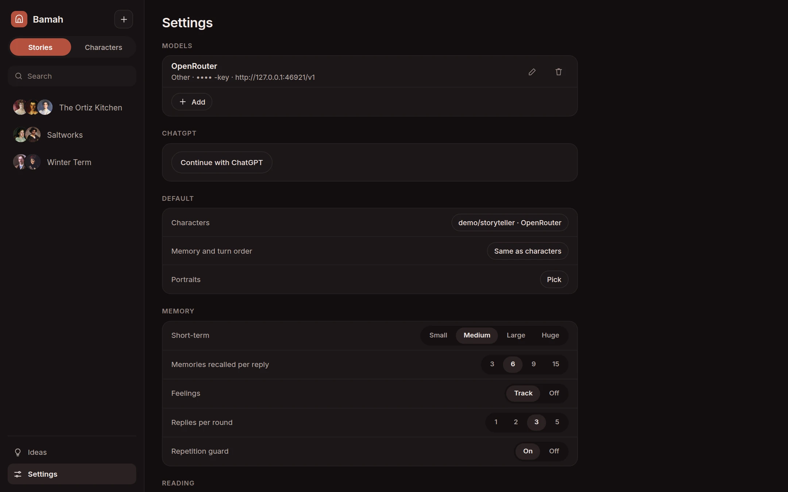

[Bamah docs](README.md) › Using it

# Settings

- **Models:** the services you've connected, and **Add**. See [Models](models.md).
- **ChatGPT:** signing in with your ChatGPT plan.
- **Default:** the model for **Characters**, for **Memory and turn order**, and for **Portraits**.
- **Memory:**
  - **Short-term:** how much of a scene each character sees word for word, from **Small** to **Huge**. Bigger is better until it gets slow or costly.
  - **Memories recalled per reply:** how many older memories come back before each line.
  - **Feelings:** **Track** keeps the feelings map up to date after every line, and **Off** stops it.
  - **Replies per round:** at most how many characters answer one of your lines.
  - **Repetition guard:** notices when a character keeps reaching for the same phrases, and asks them for fresh ones.
- **Reading:** **Text size**, **Theme** (**Dark**, **Light**, or **Auto** to follow the device), and **Tour**, which starts the guided tour again. These three are kept per device, so a phone and a computer can differ.
- **Shared journal:** notes for every story, that come to mind when one of their keyphrases comes up.
- **Data:** **Backup** downloads everything as one file, and **Sign out**.

## Ideas

The **Ideas** page has every line you starred, with your note, the story and the scene it came from. Tap the scene to go back to it, and edit the note right there.

Next: [How it works](how-it-works.md)
