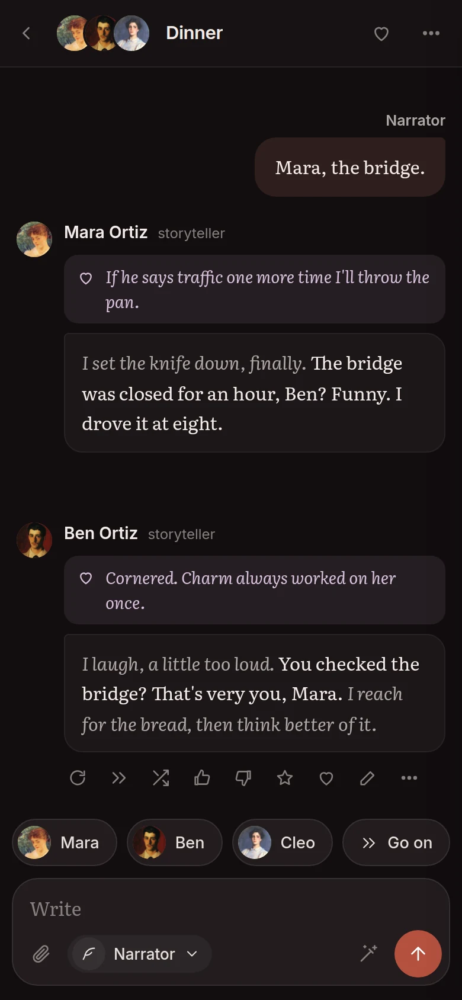
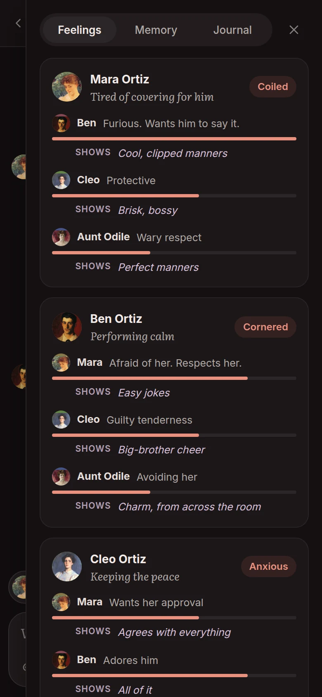

[Bamah docs](README.md) › Getting started

# What is Bamah?

Bamah is a stage for the characters of a story. You write each character loosely, the way you'd describe them to a friend, then put a few of them in a scene, say what's going on, and watch how each of them reacts. The point isn't for the AI to write your book. It's to get to know your characters by letting them loose, and to catch the surprises.

The name is the Hebrew בָּמָה, a stage.

*Dinner in the Ortiz kitchen: what each of them says, what they keep to themselves, and how they feel about each other.*

## What makes it different

- **Groups, not just one character.** Put three people in a room, move two of them to another scene, and they take their memory with them. Every line records who was there, so nobody knows what they weren't there for.
- **What they feel.** Every reply comes with the character's private feelings, and Bamah keeps a map of each one's mood and how they feel about the others, from scene to scene. See [Feelings and memory](feelings-and-memory.md).
- **Any model.** OpenRouter, OpenAI, Claude, Gemini, your ChatGPT plan, or a model on your own computer, and each story or character can have its own. A line can be tried again with another model, to compare. See [Models](models.md).
- **Your corrections stick.** When a character says something they never would, you say so once, and it goes on their sheet.

## What you need

- **Bamah itself**, either on a server you open in the browser or on your own computer. It's one small program in a Docker container. See [Developing and running it](DEVELOPING.md).
- **A model.** A key from one of the services, or your ChatGPT plan, or Ollama on your own computer, which needs no key at all.

That's all. Everything you write stays in one folder where Bamah runs: the characters, the stories, the portraits and the settings.

## On a phone

Bamah works in a phone's browser too. The scene fills the screen, the faces and the writing box sit at the bottom, and the heart at the top opens the Feelings panel. Add it to the home screen and it opens like an app.

 

Next: [Characters](characters.md)
